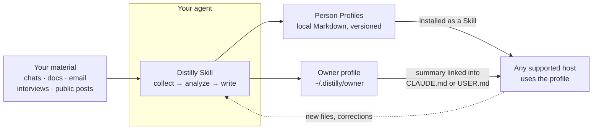

<div align="center">


# Distilly

**Turn what someone has written and said into a Person Profile your agent can use.**

[](LICENSE)
[](https://python.org)
[](https://agentskills.io)
[](https://arxiv.org/abs/2605.31264)
[](https://discord.gg/NVX66RxWZv)

English · [Chinese](docs/lang/README_ZH.md) · [Spanish](docs/lang/README_ES.md) · [German](docs/lang/README_DE.md) · [Japanese](docs/lang/README_JA.md) · [Russian](docs/lang/README_RU.md) · [Portuguese](docs/lang/README_PT.md) · [Korean](docs/lang/README_KO.md)

</div>

Distilly reads chats, documents, interviews and public sources, and distills a person's experience, judgment, voice and ways of working into a source-grounded **Person Profile**. Each profile ships as a standard Agent Skill, so any supported agent can install and use it. Distilly models what the material shows; it does not claim to clone the person.

> Formerly **Colleague Skill** (`colleague-skill`). Upgrading from an old install? See [migration](INSTALL_EN.md#existing-install-migration).

## Why Distilly

Personal agents now keep their own memory and connected accounts, but on day one they know nothing about you or the people you work with. Distilly gives them that context as plain files you own:

- **Know the owner.** A five-minute interview builds your own profile and links a short summary into the file your agent reads every session.
- **Keep how people work.** Capture a colleague's standards and judgment before they move on, or the way someone close to you talks.
- **Ask people you can't reach.** Build a research-backed profile of a public figure from their own words.
- **Portable and local.** Profiles are Markdown on your machine, built only from the material you provide, and the same profile installs into any supported host.

## Quick start

### 🤖 Let your agent install it

Open any supported agent and send:

> Install Distilly from `https://github.com/titanwings/distilly`, then verify that this host can discover it.

### 👤 Install it yourself

```bash
git clone https://github.com/titanwings/distilly <DISTILLY_SKILL_DIR>
```

`<DISTILLY_SKILL_DIR>` is your host's Skills directory plus `distilly`, for example `~/.claude/skills/distilly` for Claude Code. From any clone you can also run `python3 tools/install_distilly.py --host <host>`. Every host path is in the **[Install Guide](INSTALL_EN.md)**.

### Use it

| Say to your agent | You get |
|---|---|
| *"Use Distilly to set up my profile."* | Your owner profile at `~/.distilly/owner/profile.md`, summarized into `~/.claude/CLAUDE.md` (Claude Code) or `USER.md` (OpenClaw) |
| *"Use Distilly to create a Person Profile for `<person>`."* | A Skill named `{character}-{slug}` for a `colleague`, `relationship` or `celebrity` |
| *"I have new files for `<person>`"* or *"They wouldn't say that"* | The profile updated in place, with every version kept for rollback |

## How it works



1. **Collect.** Import what you have: Lark, DingTalk, Slack, WeChat exports, email, PDFs, screenshots, Markdown, or public sources. Credentials are entered in your own terminal and never pass through the chat.
2. **Analyze.** Each family has its own lens: work standards and decisions for colleagues, expression and conflict patterns for relationships, a six-dimension research dossier for public figures.
3. **Write.** Distilly writes a reviewable Person Profile and packages it as an Agent Skill.
4. **Evolve.** New material merges into the right sections without overwriting earlier conclusions, and corrections take effect immediately.

More in **[How it works](docs/how-it-works.md)**, **[Data sources](docs/data-sources.md)** and **[Examples](docs/examples.md)**.

## Supported agents

Distilly is discovered natively as a local Skill by eight agent hosts:

<table>
<tr>
<td align="center" width="25%"><a href="https://claude.ai/code"><picture><source media="(prefers-color-scheme: dark)" srcset="docs/assets/hosts/claude-code-wordmark-dark.svg"></picture></a></td>
<td align="center" width="25%"><a href="https://github.com/NousResearch/hermes-agent"></a></td>
<td align="center" width="25%"><a href="https://github.com/openclaw/openclaw"><picture><source media="(prefers-color-scheme: dark)" srcset="docs/assets/hosts/openclaw-wordmark-dark.svg"></picture></a></td>
<td align="center" width="25%"><a href="https://github.com/openai/codex" title="Codex"><picture><source media="(prefers-color-scheme: dark)" srcset="docs/assets/hosts/codex-mark-dark.png"></picture></a></td>
</tr>
<tr>
<td align="center" width="25%"><a href="https://github.com/deepseek-ai/deepseek-harness"><picture><source media="(prefers-color-scheme: dark)" srcset="docs/assets/hosts/deepseek-wordmark-dark.svg"></picture></a></td>
<td align="center" width="25%"><a href="https://pi.dev/docs/latest/skills"></a></td>
<td align="center" width="25%"><a href="https://docs.x.ai/build/features/skills-plugins-marketplaces"><picture><source media="(prefers-color-scheme: dark)" srcset="docs/assets/hosts/grok-build-mark-dark.png"></picture></a></td>
<td align="center" width="25%"><a href="https://opencode.ai/docs/skills"><picture><source media="(prefers-color-scheme: dark)" srcset="docs/assets/hosts/opencode-wordmark-dark.svg"></picture></a></td>
</tr>
</table>

Grok Bot can run Distilly as a manually saved Skill (preview). Meta Muse and OpenAI Dots are planned. Status for each host is in **[Hosts](docs/hosts.md)**.

## Documentation

| | |
|---|---|
| [Install Guide](INSTALL_EN.md) | Host paths, generated-profile install, collector setup, celebrity research tools |
| [How it works](docs/how-it-works.md) | Person families, profile structure, evolution, choosing good source material |
| [Data sources](docs/data-sources.md) | Every supported source and what it can collect |
| [Hosts](docs/hosts.md) | Native hosts and personal-agent support status |
| [Examples](docs/examples.md) | Sample conversations, plus the [community gallery](https://titanwings.github.io/colleague-skill-site/) |
| [Roadmap](ROADMAP.md) · [News](docs/news.md) | What's next and what has shipped |
| [Contributing](CONTRIBUTING.md) | How to report bugs and send changes |

## Citation

Distilly grew out of COLLEAGUE.SKILL. If you use it in research, please cite the [technical report](https://arxiv.org/abs/2605.31264):

```bibtex
@misc{zhou2026colleagueskill,
  title        = {COLLEAGUE.SKILL: Automated AI Skill Generation via Expert Knowledge Distillation},
  author       = {Tianyi Zhou and Dongrui Liu and Leitao Yuan and Jing Shao and Xia Hu},
  year         = {2026},
  eprint       = {2605.31264},
  archivePrefix = {arXiv},
  primaryClass = {cs.AI},
  url          = {https://arxiv.org/abs/2605.31264}
}
```

Machine-readable metadata is in [CITATION.cff](CITATION.cff).

## License

[MIT](LICENSE) © [titanwings](https://github.com/titanwings). Join us on [Discord](https://discord.gg/NVX66RxWZv).
