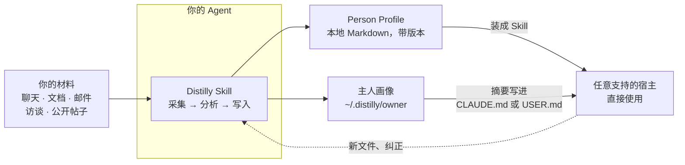

<div align="center">


# Distilly

**把一个人写过、说过的东西，变成你的 Agent 能用的 Person Profile。**

[](../../LICENSE)
[](https://python.org)
[](https://agentskills.io)
[](https://arxiv.org/abs/2605.31264)
[](https://discord.gg/NVX66RxWZv)

[English](../../README.md) · 简体中文 · [Español](README_ES.md) · [Deutsch](README_DE.md) · [日本語](README_JA.md) · [Русский](README_RU.md) · [Português](README_PT.md) · [한국어](README_KO.md)

</div>

Distilly 读取聊天记录、文档、访谈和公开资料，把一个人的经验、判断、表达方式和工作方法蒸馏成基于材料的 **Person Profile**。每份 Profile 都封装成标准的 Agent Skill，任何支持的 Agent 都能安装和使用。Distilly 只整理材料里能看到的东西，不声称复制背后的真人。

> 原名 **Colleague Skill**（`colleague-skill`，原同事 Skill）。从旧版本升级请看[迁移说明](../../INSTALL.md#existing-install-migration)。

## 为什么用 Distilly

个人 Agent 现在都有自己的记忆和连接的账号，但第一天它对你、对你身边的人一无所知。Distilly 用你自己掌握的普通文件把这些背景交给它：

- **认识主人。** 五分钟的问答生成你自己的画像，并把简短摘要写进 Agent 每次会话都会读的文件。
- **留住一个人的做事方式。** 在同事离开之前留下他的标准和判断，或者留住身边人说话的样子。
- **问问够不着的人。** 用名人自己说过的话，做一份有研究支撑的画像。
- **可移植，存在本地。** Profile 是你电脑上的 Markdown，只根据你提供的材料生成，同一份 Profile 能装进任何支持的宿主。

## 快速上手

### 🤖 让 Agent 帮你装

打开任意支持的 Agent，发送：

> 从 `https://github.com/titanwings/distilly` 安装 Distilly，并确认当前宿主可以发现它。

### 👤 自己装

```bash
git clone https://github.com/titanwings/distilly <DISTILLY_SKILL_DIR>
```

`<DISTILLY_SKILL_DIR>` 是宿主的 Skills 目录加上 `distilly`，比如 Claude Code 是 `~/.claude/skills/distilly`。在任意 clone 里也可以运行 `python3 tools/install_distilly.py --host <host>`。所有宿主的路径见 **[安装说明](../../INSTALL.md)**。

### 开始使用

| 对 Agent 说 | 得到 |
|---|---|
| *“用 Distilly 建立我的画像。”* | 你的主人画像，保存在 `~/.distilly/owner/profile.md`，摘要写进 `~/.claude/CLAUDE.md`（Claude Code）或 `USER.md`（OpenClaw） |
| *“用 Distilly 为 `<人物>` 创建一个 Person Profile。”* | 一个名为 `{character}-{slug}` 的 Skill，类型是 `colleague`、`relationship` 或 `celebrity` |
| *“我有 `<人物>` 的新文件”* 或 *“他不会这么说”* | Profile 原地更新，每个版本都留档，可以回滚 |

## 工作原理



1. **采集。** 导入你手上有的材料：飞书、钉钉、Slack、微信导出、邮件、PDF、截图、Markdown 或公开资料。凭证在你自己的终端里输入，不经过对话。
2. **分析。** 每类人物有自己的视角：同事看工作标准和决策，亲密关系看表达和冲突模式，名人做六维度研究档案。
3. **写入。** Distilly 生成一份可审阅的 Person Profile，并封装成 Agent Skill。
4. **演化。** 新材料合并进对应部分，不覆盖已有结论；对话里的纠正立即生效。

详见 **[How it works](../how-it-works.md)**、**[数据来源](../data-sources.md)** 和 **[示例](../examples.md)**（英文）。

## 支持的 Agent

Distilly 可以被 8 个 Agent 宿主作为本地 Skill 原生发现：

<table>
<tr>
<td align="center" width="25%"><a href="https://claude.ai/code"><picture><source media="(prefers-color-scheme: dark)" srcset="../assets/hosts/claude-code-wordmark-dark.svg"></picture></a></td>
<td align="center" width="25%"><a href="https://github.com/NousResearch/hermes-agent"></a></td>
<td align="center" width="25%"><a href="https://github.com/openclaw/openclaw"><picture><source media="(prefers-color-scheme: dark)" srcset="../assets/hosts/openclaw-wordmark-dark.svg"></picture></a></td>
<td align="center" width="25%"><a href="https://github.com/openai/codex" title="Codex"><picture><source media="(prefers-color-scheme: dark)" srcset="../assets/hosts/codex-mark-dark.png"></picture></a></td>
</tr>
<tr>
<td align="center" width="25%"><a href="https://github.com/deepseek-ai/deepseek-harness"><picture><source media="(prefers-color-scheme: dark)" srcset="../assets/hosts/deepseek-wordmark-dark.svg"></picture></a></td>
<td align="center" width="25%"><a href="https://pi.dev/docs/latest/skills"></a></td>
<td align="center" width="25%"><a href="https://docs.x.ai/build/features/skills-plugins-marketplaces"><picture><source media="(prefers-color-scheme: dark)" srcset="../assets/hosts/grok-build-mark-dark.png"></picture></a></td>
<td align="center" width="25%"><a href="https://opencode.ai/docs/skills"><picture><source media="(prefers-color-scheme: dark)" srcset="../assets/hosts/opencode-wordmark-dark.svg"></picture></a></td>
</tr>
</table>

Grok Bot 可以手动保存为 Skill 使用（预览）。Meta Muse 和 OpenAI Dots 在规划中。各宿主状态见 **[Hosts](../hosts.md)**。

## 文档

| | |
|---|---|
| [安装说明](../../INSTALL.md) | 宿主路径、生成 Profile 的安装、采集器配置、名人研究工具 |
| [How it works](../how-it-works.md) | 人物类型、Profile 结构、演化机制、怎么选原材料 |
| [数据来源](../data-sources.md) | 支持的所有来源和各自能采集什么 |
| [Hosts](../hosts.md) | 原生宿主和个人 Agent 的支持状态 |
| [示例](../examples.md) | 示例对话，以及[社区 Gallery](https://titanwings.github.io/colleague-skill-site/) |
| [路线图](../../ROADMAP.md) · [动态](../news.md) | 接下来做什么，已经发布了什么 |
| [贡献指南](../../CONTRIBUTING.md) | 怎么报 bug、怎么提交改动 |

## 引用

Distilly 的前身是 COLLEAGUE.SKILL。如果你在研究中使用了它，请引用[技术报告](https://arxiv.org/abs/2605.31264)：

```bibtex
@misc{zhou2026colleagueskill,
  title        = {COLLEAGUE.SKILL: Automated AI Skill Generation via Expert Knowledge Distillation},
  author       = {Tianyi Zhou and Dongrui Liu and Leitao Yuan and Jing Shao and Xia Hu},
  year         = {2026},
  eprint       = {2605.31264},
  archivePrefix = {arXiv},
  primaryClass = {cs.AI},
  url          = {https://arxiv.org/abs/2605.31264}
}
```

机器可读的引用信息见 [CITATION.cff](../../CITATION.cff)。

## 许可证

[MIT](../../LICENSE) © [titanwings](https://github.com/titanwings)。欢迎加入 [Discord](https://discord.gg/NVX66RxWZv)。
